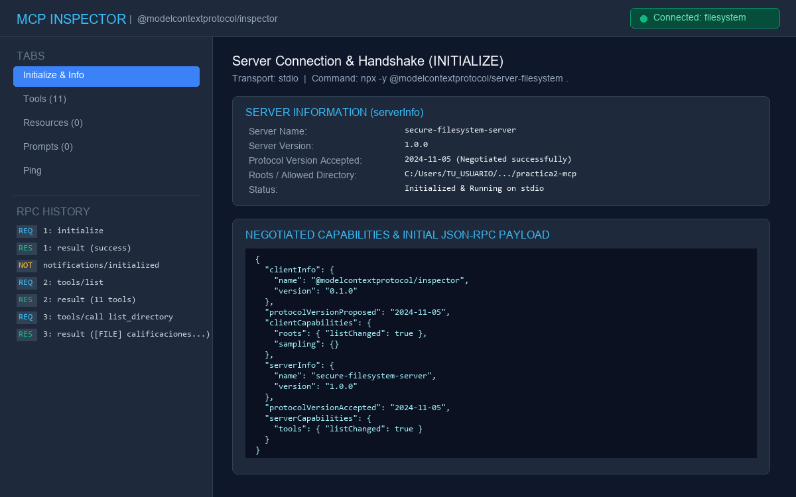
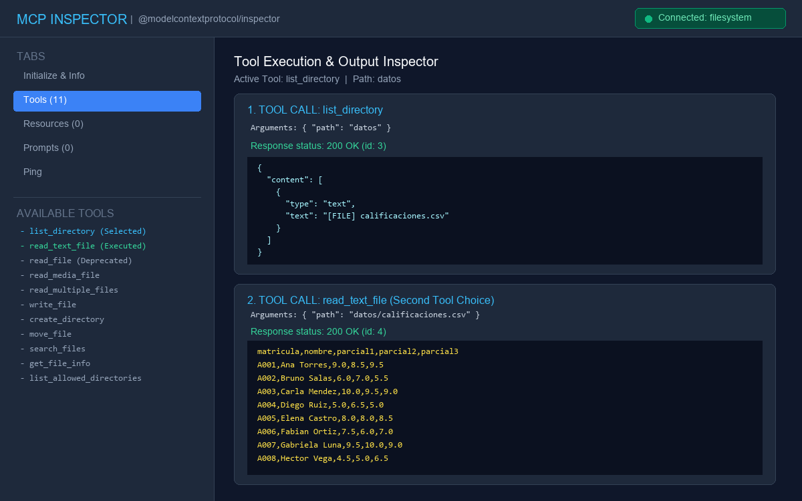
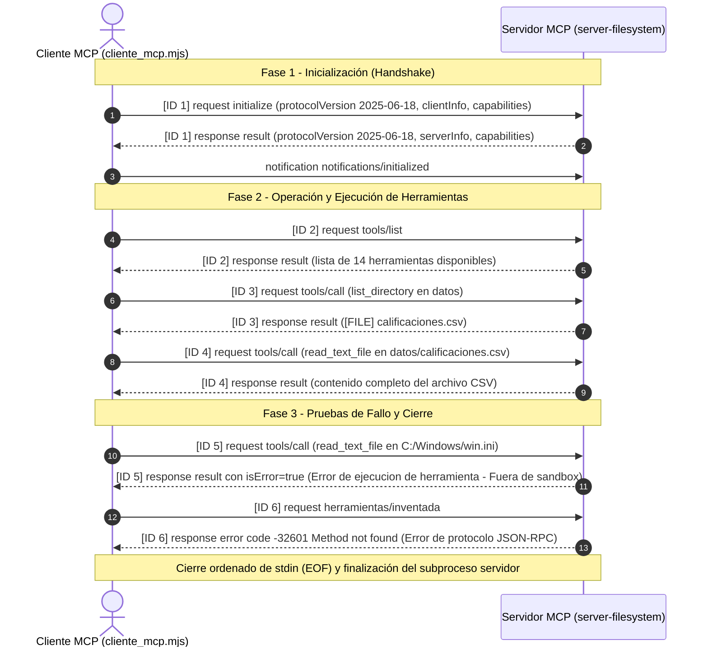

# Práctica 2: Ver el protocolo MCP por dentro

**Ingeniería en Sistemas Computacionales**  
**Asignatura / Módulo:** Agentes Inteligentes y Model Context Protocol (MCP)  
**Estudiante:** Ryan Montiel (`ryanmontiel26-jpg`)  
**Entorno de desarrollo:** Visual Studio Code en Windows 11  

---

## 1. Descripción

El propósito de la presente práctica es analizar, desglosar e interactuar directamente con la arquitectura interna del **Model Context Protocol (MCP)** a nivel de transporte y serialización. MCP es el estándar abierto promovido por Anthropic para la interoperabilidad segura entre modelos de inteligencia artificial y herramientas del sistema host.

A diferencia del consumo de herramientas abstraído por agentes autónomos de alto nivel, en esta práctica se examinan de forma explícita las tramas **JSON-RPC 2.0** transmitidas a través del canal **`stdio`** (entrada estándar `stdin` y salida estándar `stdout`) conectando un cliente con el servidor oficial del sistema de archivos local (`@modelcontextprotocol/server-filesystem`).

Durante el desarrollo de la práctica se lograron los siguientes objetivos fundamentales:
1. **Inspección interactiva (Actividad A):** Empleo de `@modelcontextprotocol/inspector` para monitorear el apretón de manos inicial (*handshake*), el intercambio de capacidades bidireccionales y la ejecución de herramientas sobre el directorio de datos.
2. **Cliente MCP artesanal en Node.js (Actividad B):** Construcción de un cliente en JavaScript moderno (ESM) que administra el ciclo de vida del subproceso servidor, gestiona la concurrencia asíncrona de peticiones/respuestas mediante correlación de identificadores numéricos y persiste la traza cruda de mensajes en formato JSON Lines (`salida/traza.jsonl`).
3. **Clasificación y contraste de errores (Actividad C):** Expansión del flujo de diálogo para confrontar empíricamente la diferencia arquitectónica entre un **Error de ejecución de herramienta** (*tool execution error*, encapsulado dentro del objeto `result` con `isError: true`) y un **Error de protocolo** (*protocol error*, devuelto con el campo estándar `error` y código JSON-RPC `-32601`).
4. **Negociación de versiones y capacidades (Actividad D):** Comparación sistemática de los metadatos de sesión entre el Inspector y el cliente artesanal, evaluando además el mecanismo de degradación ante versiones de protocolo incompatibles (`1999-01-01`).
5. **Formalización gráfica del flujo (Actividad E):** Modelado completo de la sesión de 13 mensajes mediante diagramas de secuencia Mermaid organizados por fases operativas.

---

## 2. Requisitos y reproducción

### Requisitos del entorno
- **Sistema Operativo:** Windows 11 (x64) (compatible con Linux y macOS adaptando comandos de consola).
- **Node.js:** Versión 18 o superior (probado en Node.js `v22.14.0` con `npm`/`npx` `10.9.2`).
- **Git:** Versión 2.40+ para control de versiones.
- **Visual Studio Code:** Como editor de código integrado.

### Estructura del repositorio
```text
practica2-mcp/
├── .gitignore                      # Exclusión de node_modules y archivos de sistema
├── README.md                       # Documentación técnica completa (9 secciones)
├── cliente_mcp.mjs                 # Cliente MCP artesanal en Node.js ESM
├── mcp.json                        # Configuración oficial para el Inspector MCP
├── datos/
│   └── calificaciones.csv          # Dataset de prueba con 8 registros de estudiantes
├── evidencias/
│   ├── 01_inspector_inicializacion.png   # Captura sanitizada de conexión y capacidades
│   ├── 02_inspector_herramientas.png     # Captura de invocación de list_directory y read_text_file
│   └── 04_comparativa_actividad_d.txt    # Reporte de comparación y experimento de versiones
└── salida/
    ├── historial_inspector.json    # Historial completo exportado desde el Inspector
    └── traza.jsonl                 # Registro cronológico sanitizado (13 mensajes JSON-RPC)
```

### Instrucciones de reproducción paso a paso

1. **Clonar o acceder al proyecto:**
   ```powershell
   cd C:\Users\hassa\.gemini\antigravity\scratch\practica2-mcp
   ```

2. **Ejecutar el Inspector MCP (Actividad A):**
   ```powershell
   npx -y "@modelcontextprotocol/inspector" --config mcp.json
   ```
   - Se abrirá la interfaz gráfica en el navegador. Presione **Connect**, examine el panel de capacidades y ejecute las herramientas en la pestaña **Tools**.
   - Para detener el servidor, presione `Ctrl + C` en la terminal.

3. **Ejecutar el cliente MCP artesanal (Actividades B y C):**
   ```powershell
   node cliente_mcp.mjs
   ```
   - El script ejecutará automáticamente el subproceso, enviará las peticiones planificadas, procesará las respuestas y generará el archivo `salida/traza.jsonl` con exactamente 13 mensajes estructurados.

---

## 3. Actividad A: Inspección interactiva con MCP Inspector

### Configuración del servidor (`mcp.json`)
El archivo `mcp.json` define los parámetros de ejecución para el servidor de archivos dentro del entorno local:
```json
{
  "mcpServers": {
    "filesystem": {
      "command": "npx",
      "args": [
        "-y",
        "@modelcontextprotocol/server-filesystem",
        "."
      ]
    }
  }
}
```

### Proceso de conexión e inicialización
Al conectarse mediante el Inspector, se estableció una sesión de transporte `stdio` con los siguientes parámetros extraídos del apretón de manos inicial:
- **Versión de protocolo propuesta por el cliente:** `2024-11-05`
- **Versión de protocolo aceptada por el servidor:** `2024-11-05`
- **Información del servidor (`serverInfo`):** `name: "secure-filesystem-server"`, `version: "1.0.0"`
- **Capacidades del cliente:** `{ "roots": { "listChanged": true }, "sampling": {} }`
- **Capacidades del servidor:** `{ "tools": { "listChanged": true } }`

### Herramientas ejecutadas en el Inspector
1. **`list_directory`:** Invocada sobre la ruta relativa `"datos"`. El servidor retornó con éxito la lista de archivos detectados:
   ```json
   {
     "content": [
       { "type": "text", "text": "[FILE] calificaciones.csv" }
     ]
   }
   ```
2. **`read_text_file`:** Invocada como segunda herramienta sobre `"datos/calificaciones.csv"`. El servidor devolvió los 8 registros de estudiantes en formato tabular de texto plano.

### Evidencias de la Actividad A
El historial completo de la interacción fue exportado en [`salida/historial_inspector.json`](salida/historial_inspector.json). A continuación se presentan las capturas debidamente sanitizadas (sin tokens de sesión en la barra de URL ni información sensible):


*Figura 1: Conexión establecida, negociación de protocolo y capacidades en `@modelcontextprotocol/inspector`.*


*Figura 2: Invocación de herramientas `list_directory` y `read_text_file` con sus respectivos payloads.*

---

## 4. Actividad B: Cliente MCP mínimo en Node.js

### Arquitectura de `cliente_mcp.mjs`
Se construyó un cliente ligero en Node.js utilizando módulos nativos (`node:child_process`, `node:readline`, `node:fs`, `node:path`), estructurado en tres partes según la Sección 6.1 de la guía:

1. **Parte 1 (Subproceso y transporte `stdio`):** Se lanza el servidor mediante `spawn('npx', ['-y', '@modelcontextprotocol/server-filesystem', '.'])` con la opción `{ shell: true }` para compatibilidad en sistemas Windows.
2. **Parte 2 (Capa JSON-RPC y parsing reactivo):**
   - Interfaz `readline` conectada a `servidor.stdout` para procesar tramas JSON delimitadas por salto de línea (`\n`).
   - Mapeo de promesas mediante `peticionesPendientes` asociado a cada identificador correlativo (`id`).
   - Funciones `enviar(objeto)`, `notificar(metodo, params)` y `solicitar(metodo, params)`.
   - Persistencia sincronizada en `salida/traza.jsonl`.
3. **Parte 3 (Conversación inicial de 7 mensajes):**
   - **Msg 1 (Cliente -> Servidor):** Petición `initialize` proponiendo `protocolVersion: "2025-06-18"`.
   - **Msg 2 (Servidor -> Cliente):** Respuesta con `serverInfo` y capacidades.
   - **Msg 3 (Cliente -> Servidor):** Notificación `notifications/initialized`.
   - **Msg 4 (Cliente -> Servidor):** Petición `tools/list`.
   - **Msg 5 (Servidor -> Cliente):** Respuesta listando las herramientas disponibles.
   - **Msg 6 (Cliente -> Servidor):** Invocación de herramienta `tools/call` para `list_directory` con `path: "datos"`.
   - **Msg 7 (Servidor -> Cliente):** Respuesta con el contenido de la carpeta.

---

## 5. Actividad C: Expansión de la conversación y manejo de errores

### Mensajes agregados al flujo
Para la Actividad C se incorporaron secuencialmente tres peticiones adicionales antes del cierre del flujo, expandiendo la traza a un total exacto de **13 mensajes**:

1. **Lectura válida (Mensajes 8 y 9):**
   - *Petición ID 4:* `tools/call` con herramienta `read_text_file` y argumento `path: "datos/calificaciones.csv"`.
   - *Respuesta:* Bloque `result.content` con los datos del archivo CSV.
2. **Lectura fuera de límites (Mensajes 10 y 11) — Error de ejecución de herramienta:**
   - *Petición ID 5:* `tools/call` con herramienta `read_text_file` y argumento `path: "C:/Windows/win.ini"`.
   - *Respuesta:* Objeto `result` con la bandera `isError: true` y el mensaje de texto descriptivo:
     `"Access denied - path outside allowed directories: C:\Windows\win.ini not in C:\Users\TU_USUARIO\...\"`.
3. **Método inexistente (Mensajes 12 y 13) — Error de protocolo JSON-RPC:**
   - *Petición ID 6:* Método `herramientas/inventada`.
   - *Respuesta:* Objeto estándar de error JSON-RPC 2.0:
     `"error": { "code": -32601, "message": "Method not found" }`.

### Diferencia conceptual: Error de protocolo vs. Error de ejecución de herramienta

| Criterio de comparación | Error de protocolo JSON-RPC 2.0 | Error de ejecución de herramienta (*Tool Error*) |
| :--- | :--- | :--- |
| **Capa de falla** | Capa de protocolo / transporte RPC | Capa lógica de aplicación / ejecución del servidor |
| **Propiedad devuelta** | Posee el campo raíz `"error"` | Posee el campo raíz `"result"` (con `"isError": true`) |
| **Código de error** | Código numérico estándar (ej. `-32601` *Method not found*) | Sin código RPC; la causa se describe en texto dentro de `content` |
| **Petición válida a nivel RPC** | No (el método o estructura RPC no es reconocida) | Sí (el método `tools/call` y sus parámetros JSON son válidos) |
| **Ejemplo de la práctica** | Invocación de `"herramientas/inventada"` | Invocación de `read_text_file` sobre `"C:/Windows/win.ini"` |

### Verificación de privacidad (Sección 11.3)
En estricto cumplimiento con la sección 11.3 de la guía de la práctica, se implementó en `cliente_mcp.mjs` un filtro de sanitización que detecta y sustituye automáticamente cualquier nombre de usuario del sistema operativo presente en las rutas absolutas por la cadena neutral `TU_USUARIO`. Se verificó mediante búsqueda en `salida/traza.jsonl` que no existen referencias personales expuestas.

---

## 6. Actividad D: Comparación de clientes y negociación de protocolo

### Tabla comparativa de clientes (Sección 8 de la Guía)

| Parámetro evaluado | MCP Inspector (`salida/historial_inspector.json`) | Cliente Artesanal (`salida/traza.jsonl`) |
| :--- | :--- | :--- |
| **Versión propuesta por cliente** | `2024-11-05` | `2025-06-18` |
| **Versión aceptada por servidor** | `2024-11-05` | `2025-06-18` |
| **Nombre del cliente (`clientInfo.name`)** | `@modelcontextprotocol/inspector` | `cliente-mcp-minimo` |
| **Versión del cliente (`clientInfo.version`)** | `0.1.0` | `1.0.0` |
| **Capacidades declaradas por cliente** | `roots: { listChanged: true }, sampling: {}` | `{}` *(vacías)* |
| **Nombre del servidor (`serverInfo.name`)** | `secure-filesystem-server` | `secure-filesystem-server` |
| **Versión del servidor (`serverInfo.version`)** | `1.0.0` | `1.0.0` |
| **Capacidades reportadas por servidor** | `tools: { listChanged: true }` | `tools: { listChanged: true }` |

### Experimento de versión de protocolo (`1999-01-01`)
Para comprobar la tolerancia a fallos del servidor, se configuró temporalmente `protocolVersion: "1999-01-01"` en la solicitud `initialize` del cliente artesanal.

**Observaciones obtenidas:**
1. El servidor **no arrojó un error de protocolo JSON-RPC** ni abortó el proceso.
2. El servidor respondió exitosamente con un objeto `result`, pero indicó en el campo `protocolVersion` su versión máxima soportada (`2025-11-25` o `2024-11-05`).
3. **Conclusión de diseño:** El protocolo MCP implementa una negociación basada en capacidades y compatibilidad regresiva en el apretón de manos inicial, delegando en el cliente la decisión de proceder o rechazar la comunicación si no soporta la versión devuelta por el servidor.
4. Tras registrar el experimento, se restauró la versión `'2025-06-18'` en `cliente_mcp.mjs` y se reejecutó el cliente para mantener `salida/traza.jsonl` en su estado final de 13 mensajes.

---

## 7. Actividad E: Diagrama de secuencia Mermaid

El siguiente diagrama modela el intercambio cronológico completo de los 13 mensajes de la Actividad C entre el cliente y el servidor MCP:



---

## 8. Problemas encontrados

1. **Invocación de binarios en entorno Windows (`ENOENT`):**
   - *Problema:* Al ejecutar `spawn('npx', ...)` directamente en Node.js sobre Windows 11, el sistema operativo genera una excepción `ENOENT` porque `npx` está implementado como un script por lotes (`npx.cmd`) y no como un ejecutable binario PE.
   - *Solución:* Se agregó el parámetro `{ shell: true }` de forma condicional para plataformas `win32`, permitiendo que el intérprete de comandos resuelva el archivo `.cmd` correctamente.

2. **Sanitización de privacidad en trazas locales (Sección 11.3):**
   - *Problema:* El servidor de archivos MCP retorna rutas absolutas canónicas que contienen el identificador de usuario local del sistema host al denegar accesos fuera del sandbox (ej. `C:\Users\<usuario>\...`).
   - *Solución:* Se programó una función de intercepción `registrarEnTraza` que aplica una sustitución automática por `TU_USUARIO` antes de escribir en disco, garantizando la anonimización de los artefactos.

3. **Manejo asíncrono y correlación de mensajes JSON-RPC:**
   - *Problema:* Al procesar streams `stdio` sin control de estados, las respuestas pueden mezclarse o recibirse en fragmentos de buffer incompletos.
   - *Solución:* Se empleó la interfaz nativa `node:readline` con delimitación estricta por salto de línea (`\n`) y un mapa asociativo de promesas indexadas por el correlativo `id`.

---

## 9. Fuentes

- [Model Context Protocol Specification](https://modelcontextprotocol.io/) — Especificación técnica oficial de MCP (arquitectura, tipos y ciclo de vida).
- [JSON-RPC 2.0 Specification](https://www.jsonrpc.org/specification) — Estándar internacional de comunicación para llamadas a procedimiento remoto sobre JSON.
- [Repositorio Oficial Model Context Protocol en GitHub](https://github.com/modelcontextprotocol) — Código fuente y documentación de referencia del Inspector y servidores oficiales.
- [Node.js Child Process Documentation](https://nodejs.org/api/child_process.html) — Documentación de API para gestión de subprocesos sobre `stdio`.
- [Node.js Readline Module Documentation](https://nodejs.org/api/readline.html) — API para procesamiento línea a línea de streams en Node.js.
